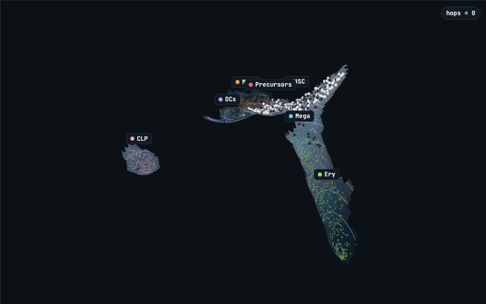

# scJDO2

**Per-cell local operators for single-cell RNA-seq.** For every cell, scJDO2
estimates a small matrix $J_c$ that describes how nearby cells move relative to
each other: whether they converge (a stable state), separate (a branch point) or
rotate. It works on an `AnnData` and writes its results back into it.

<p align="center">
  <a href="https://manarai.github.io/scJDO2/gallery/palantir_routes.html">
    
  </a>
  <br>
  <em>Route simulation on CD34+ marrow (Setty et al. 2019): walkers start in HSC and hop
  between measured cells along scJDO2's drift, here directed by Palantir pseudotime, so where
  they end is the model's tendency, not a measured fate.
  <a href="https://manarai.github.io/scJDO2/gallery/palantir_routes.html">Open it interactively</a> ·
  <a href="docs/gallery/">gallery and how it is made</a></em>
</p>

```python
import scjdo2 as sj
sj.flow(adata, time_key="day")       # one call: a flow operator for every cell
adata.obs["flow_lambda1"]             # leading eigenvalue: high at branch points
```

There are two routes. Pick one by the kind of data you have:

| your data | route | what $J_c$ means | main call |
|---|---|---|---|
| **time course**: cells sampled at ≥ 2 times | flow operator | Jacobian of the drift, estimated from how the population moves between times | `sj.flow` |
| **snapshot**: one time point | energy operator | curvature of the cell density (where cells are dense, sparse or saddle-shaped), **not** dynamics | `sj.fit` |

If you have a time course, use the flow route. The snapshot route answers a
narrower question; [docs/math.md §3.3](docs/math.md#33-why-this-is-density-curvature-not-stability)
explains why a snapshot cannot give stability.

---

## Install

```bash
git clone https://github.com/manarai/scJDO2.git
cd scJDO2
python -m venv .venv && source .venv/bin/activate
pip install -e .            # Python ≥ 3.10; installs torch, POT, anndata, scanpy
```

`pip install -e ".[dev]"` adds pytest and Jupyter. A GPU is optional
(`device="cuda"` or `"mps"`); the examples below run on a laptop CPU.

## Quickstart 1: a time course

```bash
python examples/flow_quickstart.py          # ~10 s on a laptop CPU
```

The script simulates 2,000 cells at five times that split into two branches
after $t = 2$, runs `sj.flow`, and prints:

```
median lambda_1  branch point (t=2): +2.341   committed (t=4): -0.263
branch vs committed AUC of lambda_1: 1.00
```

On your own data:

```python
import scanpy as sc
import scjdo2 as sj

adata = sc.read_h5ad("timecourse.h5ad")              # obs["day"]: numeric sampling time
sc.pp.normalize_total(adata); sc.pp.log1p(adata)
sc.pp.highly_variable_genes(adata, n_top_genes=2000, subset=True)
sc.tl.pca(adata, n_comps=15)                         # unwhitened PCA, 10–20 components

sj.flow(adata, time_key="day")                       # transport → drift → J_flow per cell
tab = sj.flow_groups(adata, "cell_type")             # median λ₁ per group, 95% bootstrap CI
st  = sj.flow_stability(adata, groupby="cell_type")  # do refits with other seeds agree?
```

Or run everything and save it to a folder with a figure:

```python
sj.run(adata, "runs/my_timecourse", cluster_key="cell_type", time_key="day",
       stability_seeds=(0, 1, 2))
```

## Quickstart 2: a snapshot

```bash
python examples/snapshot_quickstart.py      # ~20 s; writes runs/snapshot_quickstart/
```

The script samples cells from a double well (two dense clusters joined by a
thin bridge) and runs the energy route. Cells in the clusters are labelled
*holder* (density peak) and cells on the bridge *fork* (saddle):

```
  left: median lead eigenvalue -0.884   holder 0.98  fork 0.02  drift 0.00
bridge: median lead eigenvalue +2.233   holder 0.00  fork 1.00  drift 0.00
 right: median lead eigenvalue -0.910   holder 0.97  fork 0.03  drift 0.01
```

On your own data:

```python
summary = sj.run(adata, "runs/my_snapshot", cluster_key="cell_type", use_rep="X_pca")
# or step by step:
drift = sj.fit(adata, use_rep="X_pca")                     # energy operator per cell
sj.analyse(adata, cluster_key="cell_type", drift=drift)    # holder / fork / drift labels
sj.figures(adata, "figures/", cluster_key="cell_type")     # every figure the data supports
```

If you also have measured directions (metabolic labelling, RNA velocity,
lineage barcodes, pseudotime), `sj.orient` uses them to give the operator's
axes a direction. See [API.md §3](API.md#3-sjorient--directions).

## What you get

| result | where | route |
|---|---|---|
| per-cell operators $J_c$, shape (cells × d × d) | `uns["scjdo2"]["J"]` | both |
| leading eigenvalue $\lambda_1$ | `obs["flow_lambda1"]` | flow |
| OT velocity and fitted drift | `obsm["flow_velocity"]`, `obsm["flow_drift"]` | flow |
| eight coordinate-free descriptors (and their ranks) | `obsm["flow_descriptors"]`, `obsm["flow_descriptor_ranks"]` | flow |
| group table: median λ₁, interval, rank | returned by `sj.flow_groups`; `uns["flow"]["groups"]` | flow |
| refit agreement | returned by `sj.flow_stability`; `obs["flow_lambda1_rank_sd"]` | flow |
| holder / fork / drift label, basin index | `obs["op_behaviour_basin"]`, `obs["op_basin_index"]` | energy |
| energy $E(z)$ (low = dense) | `obs["energy"]` | energy |
| oriented axes, rotation, conflicts | `obs["flow_orientation_class"]`, `obsm["orient_flow_sign"]`, … | energy + `orient` |

`sj.run` also writes `summary.json`, `per_cell.csv`, `figures/` and the
AnnData; reload a run with `scjdo2.io.load("runs/x")`.

## How to read the results

* **Compare groups, not single cells.** λ₁ is a within-dataset branch-point
  score. Group medians stayed stable across refits in our tests; per-cell
  rankings agreed only moderately (median Spearman 0.56). Run
  `sj.flow_stability` before interpreting individual cells.
* **Not a regulatory network.** The entries of $J_c$ do not recover the true
  gene–gene Jacobian. Use the eigenvalues and descriptors.
* **Sampling matters.** Three time points were too coarse on an independent
  simulator; eight were enough. Proliferation and death are not modelled.
* **Use unwhitened PCA** (10–20 components). The flow operator degrades on
  whitened or Factor Analysis embeddings.
* **Snapshot labels describe density.** *Holder* means "local density peak",
  not "attractor". Fits recovered a known landscape in 2-d but not in 20-d;
  for $d \ge 4$ treat the labels as descriptive.
* **One operator per AnnData.** `sj.flow` and `sj.fit` refuse to overwrite
  each other; use `adata.copy()` to compute both.

## Documentation

| page | read it for |
|---|---|
| [docs/math.md](docs/math.md) | the equations behind both routes, and what each can and cannot identify |
| [docs/flow.md](docs/flow.md) | every `sj.flow` parameter and output, usage notes |
| [API.md](API.md) | every top-level function, figure and recipe |
| [examples/](examples/) | runnable scripts with test data |
| [docs/ORIENTATION_SPEC.md](docs/ORIENTATION_SPEC.md) | the full rules of `sj.orient` |
| [docs/SYNTHETIC_MULTIMODAL.md](docs/SYNTHETIC_MULTIMODAL.md) | simulated data with known truth, for testing a pipeline |
| [docs/README.md](docs/README.md) | index of all documentation |
| [CHANGELOG.md](CHANGELOG.md) | what changed, by version |

## Repository layout

```
scjdo2/            the package
  api.py             fit, analyse, orient, figures, run, flow_groups, flow_stability
  flow_operator.py   sj.flow: OT velocity, drift Jacobian, descriptors
  energy_drift.py    score-matched energy (snapshot route)
  opspace.py         eigenvalues, invariants, holder/fork/drift classifier
  orient/            orientation layer
  plot/              figures
  data/              synthetic generators and real-data loaders
examples/          quickstart scripts (start here)
docs/              method documentation
tests/             pytest suite
scripts/           analysis scripts behind the manuscript benchmarks
notebooks/         figure notebooks for the manuscript
benchmarks/        committed result tables of those benchmarks
manuscript/        manuscript sources, figures and reproduction notes
compare/           v1-vs-v2 comparison harness (needs scJDO v1; optional)
```

## Command line

```bash
scjdo2 run      --input data.h5ad --out runs/x --use-rep X_pca    # snapshot route
scjdo2 opspace  --input runs/x --out runs/x/opspace
scjdo2 figure   operator-space|archetypes|ledger --input runs/x --out figs/
```

The flow route and orientation are Python-only for now.

## Reproducing the manuscript

`scripts/appnote_validate_api.py` reruns `sj.flow` on the held-out synthetic
test sets and LARRY and compares the output with the stored results.
`notebooks/run_all.py` regenerates every figure of the preprint from committed
result tables; see [manuscript/REPRODUCE_v57.md](manuscript/REPRODUCE_v57.md)
and [notebooks/README.md](notebooks/README.md).

## Tests

```bash
pip install -e ".[dev]"
python -m pytest -q
```

A few benchmark tests read simulated data files that are too large to commit;
they fail when those files are absent. The package and API tests do not need them.

## Relation to scJDO (v1)

scJDO2 succeeds [scJDO](https://github.com/manarai/scJDO). It does not import
v1 and does not port v1's Schrödinger-bridge, regulatory-inference or Koopman
pipelines; only the Henrici index and transient gain are reimplemented. v1 is
used only by the optional comparison harness in `compare/`
([docs/V1_REMOVAL.md](docs/V1_REMOVAL.md)).

## Citation

If you use scJDO2, please cite the preprint (see [CITATION.cff](CITATION.cff)):

> Redd D., Green S., Terooatea T. W. (2026). Label-free flow operators and
> stability operators from single-cell time courses: what local dynamical
> operators can and cannot identify. *bioRxiv*.
> doi:[10.64898/2026.08.21.745996](https://doi.org/10.64898/2026.08.21.745996)

## License

MIT; see [LICENSE](LICENSE).
