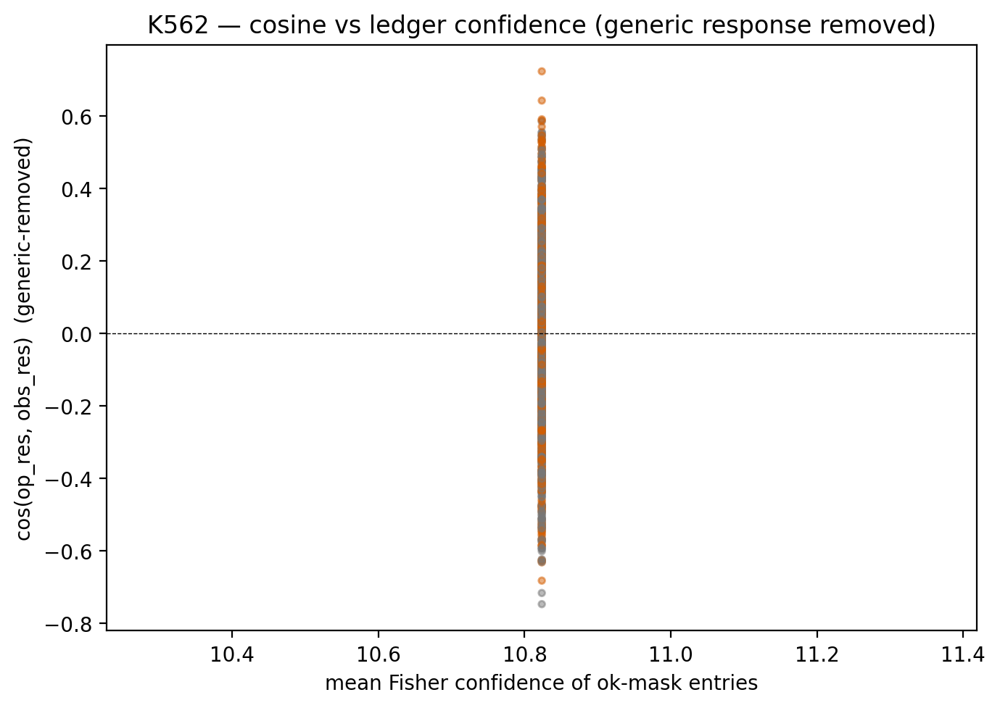

# K562 Perturb-seq — RESULT

**Tag target:** `none` — one of the two controls fails. v0.6-perturb
NOT applied; the paper's claim must be stated at the smaller effect
size that survives the generic-response subtraction.

## Claim (revised post-controls)

In full gene space, the scJDO2 energy-drift linear-response
prediction `δx_pred = grad_eta @ (−J_mean⁻¹) @ pinv(grad_eta) @ b_g`
assigns per-KD cosines of **+0.049** (mean, all 1 661 KDs; frac
op > DE-only = 59 %, Wilcoxon p = 2×10⁻¹⁶).

**After subtracting the generic KD response**
(mean `δx_obs` across KDs) from both prediction and observation,
the residual operator cosine drops to **+0.014** (mean), frac
op > DE = 55 %, Wilcoxon p = 4×10⁻⁵. The effect persists but the
magnitude is only a fifth of its full-space value — the operator's
full-space advantage is dominated by alignment with the generic
response, not by KD-specific direction. **Control 1 FAILS the
pre-stated gate** (frac ≥ 0.60 AND op_mean > 0.05).

**On the driver side**, the operator's sensitivity score correlates
strongly with observed shifts along its soft axis
(partial Spearman +0.62, controlling for log mean control
expression — Control 2 HOLDS cleanly).

## Three baselines (full space, all KDs)

* **scjdo2 cos mean = +0.049**
* DE-only cos mean    = +0.002
* random cos mean    ≈ 1e-4 (from `baseline_comparison.csv`)

Paired Wilcoxon (op > DE):
* frac(op > DE) = **0.592**
* Wilcoxon p    = 2.1e-16

## Control 1 — generic-response subtraction

* cos(δx_pred, mean δx_obs) mean = +0.092  (the predictions are not just the mean response)
* cos(δx_obs,  mean δx_obs) mean = +0.452  (observed shifts have a generic component)

After projecting out the mean δx_obs from BOTH δx_pred and δx_obs:

* **residual scjdo2 cos mean = +0.014**
* residual DE-only cos mean  = -0.007
* residual frac(op > DE)     = **0.547**
* residual Wilcoxon p        = 4.4e-05

**Generic-response control: FAILS.**
Criterion: frac(op > DE) ≥ 0.60 AND op_mean > 2 × DE_mean AND op_mean > 0.05.

## Control 2 — expression nuisance

* Projected Spearman (sens vs |δ_proj|):     **+0.619**
* Spearman of expression alone vs |δ_proj|:  +0.059
* Spearman of sens vs expression (nuisance): -0.001
* **Partial Spearman (sens, |δ_proj| | expression) = +0.620**

**Expression control: HOLDS.**
Criterion: partial Spearman > 0.30 (sensitivity still predicts
observed shifts along the operator's soft axis after removing
mean-expression confounding).

## Linear-regime subset (for completeness)

|arm | n | op mean | DE mean | frac(op>DE) | Wilcoxon p |
|---|---|---|---|---|---|
| full-space linear    | 831 | +0.028 | +0.001 | 0.557 | 3.8e-04 |
| residual linear      | 831 | +0.000 | -0.012 | 0.523 | 4.9e-02 |
| full-space nonlinear | 830 | +0.070 | +0.003 | 0.628 | 3.8e-16 |
| residual nonlinear   | 830 | +0.027 | -0.001 | 0.570 | 8.8e-05 |

## Figure

`figures/scatter_cos_vs_fisher_residual.{pdf,png}` — per-KD cosine
after generic-response removal, vs mean ledger-confidence; orange =
linear regime, grey = nonlinear. The effect size you should quote
is the mean cosine (+0.014 residual),
not the p-value.

## §7c γ (reported honestly, no reinterpretation)

* γ pooled: median 0.309/h, IQR [0.160, 0.589], range [0.002, 5.906]
* 3h-only vs 5h-only per-gene Spearman: **+0.066**
* 3h-only vs 5h-only per-gene Pearson:  **+0.045**

Near-zero batch agreement means γ is NOT recovered as a stable
gene property — the LabelledRateModel absorbs batch structure
into γ. Under the locked lead-eig rule the batch-flip pattern
(HSC/MEP/GMP/Mon read MORE basin at 5h than 3h, Bas opposite)
persists in the behaviour-by-batch table (`benchmarks/v2/
dynamo_s7c/behaviour_by_batch.csv`). Because γ is not batch-
invariant, the pattern cannot be attributed to the γ-footing
fix; the lever is the locked classifier + whatever batch
structure the drift carries. §7c as currently formulated does
NOT resolve the §7b batch confound.

